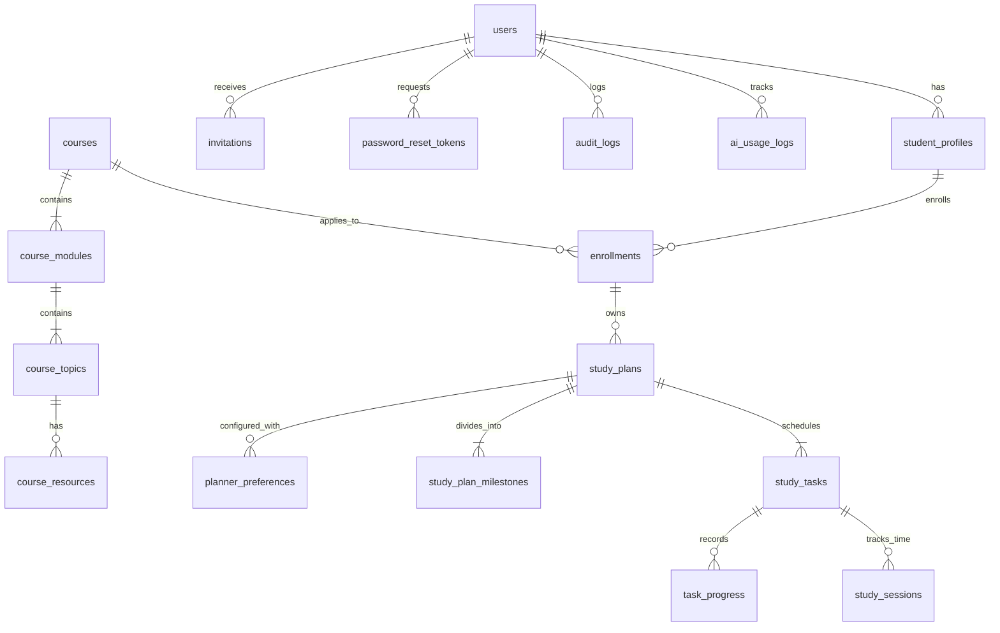

# Database Schema Documentation

## Database Engine: Supabase PostgreSQL
Single source of truth for all application data.

### Core Entity-Relationship Overview

### Table Definitions

1. **`users`**
   - `id`: UUID PRIMARY KEY
   - `email`: VARCHAR(255) UNIQUE NOT NULL
   - `password_hash`: VARCHAR(255) NULL (null until account activated)
   - `full_name`: VARCHAR(255) NOT NULL
   - `role`: VARCHAR(32) NOT NULL DEFAULT 'STUDENT' ('ADMIN', 'STUDENT', 'STAFF')
   - `is_active`: BOOLEAN NOT NULL DEFAULT TRUE
   - `created_at`: TIMESTAMP WITH TIME ZONE DEFAULT NOW()
   - `updated_at`: TIMESTAMP WITH TIME ZONE DEFAULT NOW()

2. **`student_profiles`**
   - `id`: UUID PRIMARY KEY
   - `user_id`: UUID UNIQUE REFERENCES users(id) ON DELETE CASCADE
   - `aptech_student_id`: VARCHAR(64) UNIQUE NOT NULL
   - `phone`: VARCHAR(32)
   - `current_level`: VARCHAR(32) DEFAULT 'BEGINNER'
   - `target_career`: VARCHAR(128)
   - `created_at`, `updated_at`

3. **`courses`**
   - `id`: UUID PRIMARY KEY
   - `course_code`: VARCHAR(64) UNIQUE NOT NULL
   - `name`: VARCHAR(255) NOT NULL
   - `description`: TEXT
   - `official_duration_value`: INT NOT NULL
   - `official_duration_unit`: VARCHAR(32) NOT NULL ('WEEKS', 'MONTHS', 'YEARS')
   - `total_learning_hours`: FLOAT NOT NULL
   - `syllabus_version`: VARCHAR(32) NOT NULL
   - `category`: VARCHAR(64)
   - `difficulty_level`: VARCHAR(32)
   - `prerequisites`: JSONB DEFAULT '[]'
   - `is_active`: BOOLEAN DEFAULT TRUE
   - `created_at`, `updated_at`

4. **`course_modules`**
   - `id`: UUID PRIMARY KEY
   - `course_id`: UUID REFERENCES courses(id) ON DELETE CASCADE
   - `module_code`: VARCHAR(64) NOT NULL
   - `title`: VARCHAR(255) NOT NULL
   - `description`: TEXT
   - `order_index`: INT NOT NULL
   - `estimated_hours`: FLOAT NOT NULL

5. **`course_topics`**
   - `id`: UUID PRIMARY KEY
   - `module_id`: UUID REFERENCES course_modules(id) ON DELETE CASCADE
   - `topic_code`: VARCHAR(64) NOT NULL
   - `title`: VARCHAR(255) NOT NULL
   - `description`: TEXT
   - `estimated_hours`: FLOAT NOT NULL
   - `difficulty`: VARCHAR(32) DEFAULT 'INTERMEDIATE'
   - `order_index`: INT NOT NULL
   - `subtopics`: JSONB DEFAULT '[]'

6. **`course_resources`**
   - `id`: UUID PRIMARY KEY
   - `topic_id`: UUID REFERENCES course_topics(id) ON DELETE CASCADE
   - `title`: VARCHAR(255) NOT NULL
   - `resource_type`: VARCHAR(32) NOT NULL ('DOCUMENTATION', 'PDF', 'VIDEO', 'EXERCISE')
   - `url`: TEXT NOT NULL

7. **`enrollments`**
   - `id`: UUID PRIMARY KEY
   - `student_id`: UUID REFERENCES student_profiles(id) ON DELETE CASCADE
   - `course_id`: UUID REFERENCES courses(id) ON DELETE RESTRICT
   - `status`: VARCHAR(32) NOT NULL DEFAULT 'PENDING' ('PENDING', 'ACTIVE', 'SUSPENDED', 'EXPIRED', 'CANCELLED')
   - `enrolled_date`: DATE NOT NULL DEFAULT CURRENT_DATE
   - `valid_until`: DATE
   - `payment_reference`: VARCHAR(128)
   - `notes`: TEXT
   - `created_at`, `updated_at`

8. **`planner_preferences`**
   - `id`: UUID PRIMARY KEY
   - `study_plan_id`: UUID REFERENCES study_plans(id) ON DELETE CASCADE
   - `target_completion_date`: DATE NOT NULL
   - `requested_duration_days`: INT NOT NULL
   - `daily_study_hours`: FLOAT NOT NULL
   - `available_days`: JSONB NOT NULL -- e.g. ["MON", "TUE", "WED", "THU", "FRI", "SAT"]
   - `preferred_learning_style`: VARCHAR(64)
   - `learning_goals`: JSONB DEFAULT '[]'
   - `known_topics`: JSONB DEFAULT '[]'
   - `weak_topics`: JSONB DEFAULT '[]'

9. **`study_plans`**
   - `id`: UUID PRIMARY KEY
   - `enrollment_id`: UUID REFERENCES enrollments(id) ON DELETE CASCADE
   - `student_id`: UUID REFERENCES student_profiles(id) ON DELETE CASCADE
   - `course_id`: UUID REFERENCES courses(id) ON DELETE RESTRICT
   - `title`: VARCHAR(255) NOT NULL
   - `syllabus_version`: VARCHAR(32) NOT NULL
   - `start_date`: DATE NOT NULL
   - `target_completion_date`: DATE NOT NULL
   - `total_scheduled_hours`: FLOAT NOT NULL
   - `is_active`: BOOLEAN DEFAULT TRUE
   - `status`: VARCHAR(32) DEFAULT 'IN_PROGRESS' ('IN_PROGRESS', 'COMPLETED', 'ARCHIVED')
   - `generation_source`: VARCHAR(32) DEFAULT 'HYBRID_AI' ('AI', 'DETERMINISTIC', 'HYBRID_AI')
   - `created_at`, `updated_at`

10. **`study_plan_milestones`**
    - `id`: UUID PRIMARY KEY
    - `study_plan_id`: UUID REFERENCES study_plans(id) ON DELETE CASCADE
    - `title`: VARCHAR(255) NOT NULL
    - `target_week`: INT NOT NULL
    - `target_date`: DATE NOT NULL
    - `is_completed`: BOOLEAN DEFAULT FALSE

11. **`study_tasks`**
    - `id`: UUID PRIMARY KEY
    - `study_plan_id`: UUID REFERENCES study_plans(id) ON DELETE CASCADE
    - `topic_id`: UUID REFERENCES course_topics(id) ON DELETE SET NULL
    - `title`: VARCHAR(255) NOT NULL
    - `description`: TEXT
    - `scheduled_date`: DATE NOT NULL
    - `estimated_duration_hours`: FLOAT NOT NULL
    - `actual_duration_hours`: FLOAT DEFAULT 0.0
    - `task_type`: VARCHAR(32) DEFAULT 'TOPIC' ('TOPIC', 'PRACTICE', 'REVISION', 'PROJECT', 'ASSESSMENT')
    - `status`: VARCHAR(32) DEFAULT 'NOT_STARTED' ('NOT_STARTED', 'IN_PROGRESS', 'COMPLETED', 'MISSED', 'RESCHEDULED')
    - `completed_at`: TIMESTAMP WITH TIME ZONE NULL
    - `order_index`: INT DEFAULT 1

12. **`study_sessions`**
    - `id`: UUID PRIMARY KEY
    - `task_id`: UUID REFERENCES study_tasks(id) ON DELETE CASCADE
    - `student_id`: UUID REFERENCES student_profiles(id) ON DELETE CASCADE
    - `duration_minutes`: INT NOT NULL
    - `notes`: TEXT
    - `session_date`: TIMESTAMP WITH TIME ZONE DEFAULT NOW()

13. **`invitations`**
    - `id`: UUID PRIMARY KEY
    - `user_id`: UUID REFERENCES users(id) ON DELETE CASCADE
    - `token`: VARCHAR(255) UNIQUE NOT NULL
    - `expires_at`: TIMESTAMP WITH TIME ZONE NOT NULL
    - `is_used`: BOOLEAN DEFAULT FALSE
    - `created_at`: TIMESTAMP WITH TIME ZONE DEFAULT NOW()

14. **`password_reset_tokens`**
    - `id`: UUID PRIMARY KEY
    - `user_id`: UUID REFERENCES users(id) ON DELETE CASCADE
    - `token`: VARCHAR(255) UNIQUE NOT NULL
    - `expires_at`: TIMESTAMP WITH TIME ZONE NOT NULL
    - `is_used`: BOOLEAN DEFAULT FALSE
    - `created_at`: TIMESTAMP WITH TIME ZONE DEFAULT NOW()

15. **`ai_usage_logs`**
    - `id`: UUID PRIMARY KEY
    - `user_id`: UUID REFERENCES users(id) ON DELETE SET NULL
    - `feature`: VARCHAR(64) NOT NULL ('PLANNER_GENERATION', 'AI_TUTOR', 'PRACTICE_QUIZ')
    - `model`: VARCHAR(64) NOT NULL
    - `prompt_tokens`: INT NOT NULL
    - `completion_tokens`: INT NOT NULL
    - `total_tokens`: INT NOT NULL
    - `estimated_cost_usd`: FLOAT NOT NULL
    - `created_at`: TIMESTAMP WITH TIME ZONE DEFAULT NOW()

16. **`audit_logs`**
    - `id`: UUID PRIMARY KEY
    - `actor_id`: UUID REFERENCES users(id) ON DELETE SET NULL
    - `action`: VARCHAR(64) NOT NULL
    - `resource_type`: VARCHAR(64) NOT NULL
    - `resource_id`: VARCHAR(128)
    - `details`: JSONB DEFAULT '{}'
    - `ip_address`: VARCHAR(45)
    - `created_at`: TIMESTAMP WITH TIME ZONE DEFAULT NOW()

